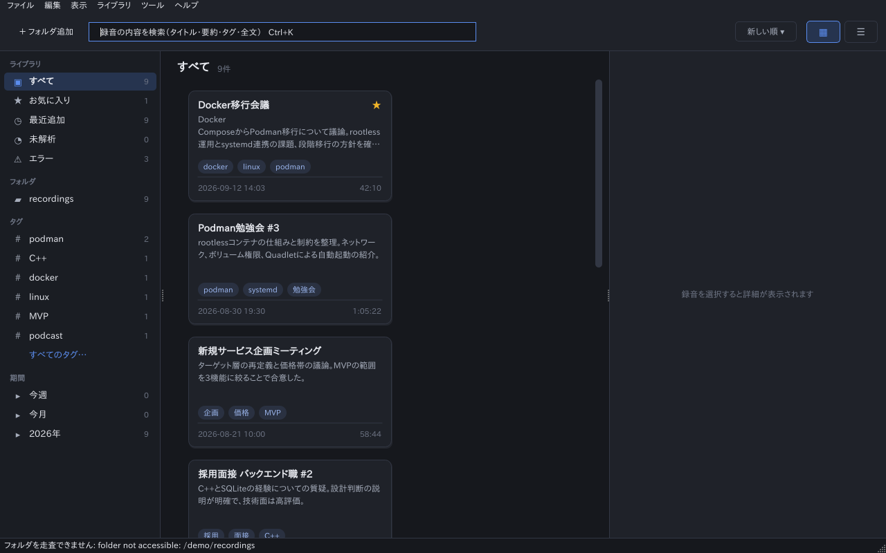

# AudioKnowledgeExplorer

> **Alpha (v0.1).** 動きますが、粗い部分があります。下の「既知の制限」を読んでください。

録音(会議・勉強会・ポッドキャスト・インタビュー・ボイスメモ)を、再生リストではなく
**検索できる「ナレッジカード」** として扱うデスクトップアプリです。
フォルダを登録すると、文字起こし・キーワード・要約・タイトルを自動で作り、カードとして並べます。
目的は「あの話をした録音はどれか」を見つけることです。

**すべてローカルで動きます。** 録音も文字起こしも外部に送りません(クラウド・LLM は使いません。要約は抽出型です)。




*(画面はダミーデータです。)*

## できること
- フォルダ登録と自動検出(mp3 / wav / m4a / flac / ogg、動画の mp4 / mov / mkv / webm は音声だけ使います)
- [whisper.cpp](https://github.com/ggml-org/whisper.cpp) による文字起こし(日本語中心)
- キーワード抽出、抽出型の要約とタイトル、タグ(1録音あたり最大8)
- 全文検索(SQLite FTS5。AND、"フレーズ"、スニペット表示)
- 検索 → タグ → 日付の順に絞り込み(サイドバーに検索結果内の件数、条件チップ、「絞り込みを外す」)
- 読みの近い語の検索(綴りで見つからないとき、誤変換された語を読みで探す。MeCab が必要)
- 文字起こしの表示とクリックでの頭出し再生、文字起こし・要約・タイトルの手動編集
- 無音やノイズだけの録音は文字起こししません(whisper の幻覚を避けるため)
- ライト/ダークテーマ、カード/リスト表示

## ビルド

必要なもの: C++17 コンパイラ、CMake ≥ 3.16、Ninja、Qt 6(6.2 以上: Widgets / Sql / Multimedia / Concurrent / Test)、
FFmpeg の開発ライブラリ(libavformat / libavcodec / libswresample / libavutil)、SQLite(FTS5 つき)。
任意: MeCab と UTF-8 の JUMAN 辞書(無いと n-gram の簡易トークナイザになり、読みの近い語の検索は使えません)。

```sh
# Ubuntu の例
sudo apt install build-essential cmake ninja-build qt6-base-dev qt6-multimedia-dev \
    libavformat-dev libavcodec-dev libswresample-dev libavutil-dev libmecab-dev

cmake -S . -B build -G Ninja          # whisper.cpp は GitHub から取得します
cmake --build build
ctest --test-dir build --output-on-failure
```

手元の whisper.cpp を使うなら `-DAKE_WHISPER_DIR=<checkout>` を付けます。
`GGML_NATIVE` が有効なので、**ビルドしたバイナリを他のマシンに配ることはできません**(ソースからのビルド前提です)。
Haiku でもビルドして動作を確認しています(`pkgman install cmake ninja qt6_base_devel qt6_multimedia_devel sqlite_devel ffmpeg6_devel`)。
Haiku には MeCab のパッケージが無いので、そのままでは n-gram 版になり、読みの近い語の検索は使えません。使うには、次のとおり MeCab と辞書を自分でビルドします。

### Haiku で MeCab を使う(ソースからビルド)
MeCab 0.996 と JUMAN 辞書(UTF-8)を、ユーザー領域の `~/config/non-packaged` に入れます。Debian の配布元の tarball を使い、取得後に sha256 を確かめます。

```sh
P=$HOME/config/non-packaged
mkdir -p ~/mecab-build && cd ~/mecab-build
B=https://deb.debian.org/debian/pool/main/m
curl -LO $B/mecab/mecab_0.996.orig.tar.gz
curl -LO $B/mecab-jumandic/mecab-jumandic_7.0-20130310.orig.tar.gz
sha256sum mecab_0.996.orig.tar.gz mecab-jumandic_7.0-20130310.orig.tar.gz
#  e073325783135b72e666145c781bb48fada583d5224fb2490fb6c1403ba69c59  mecab_0.996.orig.tar.gz
#  eaf216758edee9a159bc3d02507007318686b9537943268c4565cc1f9ef07f15  mecab-jumandic_7.0-20130310.orig.tar.gz

# 本体(`config.guess` が最近の Haiku を判定できないので --build を指定します)
tar xzf mecab_0.996.orig.tar.gz && cd mecab-0.996
./configure --build=x86_64-unknown-haiku --prefix=$P --bindir=$P/bin --libdir=$P/lib \
    --includedir=$P/develop/headers --sysconfdir=$P/settings --libexecdir=$P/lib \
    --datarootdir=$P/data --with-charset=utf8
make -j4 && make install
cd ..

# `mecab-config` は libexec を $P/libexec と答えるので、実際の場所へのリンクを張ります
mkdir -p $P/libexec && ln -sfn $P/lib/mecab $P/libexec/mecab

# 辞書(UTF-8 に変換して作るので数分かかります)
tar xzf mecab-jumandic_7.0-20130310.orig.tar.gz && cd mecab-jumandic-7.0-20130310
PATH=$P/bin:$PATH ./configure --build=x86_64-unknown-haiku --with-mecab-config=$P/bin/mecab-config \
    --with-charset=utf8 --with-dicdir=$P/lib/mecab/dic/jumandic
PATH=$P/bin:$PATH make && PATH=$P/bin:$PATH make install

# 設定ファイルの辞書を JUMAN にします
sed -i "s#^dicdir = .*#dicdir = $P/lib/mecab/dic/jumandic#" $P/settings/mecabrc
echo "症外が発生しました" | $P/bin/mecab        # 「症 / 外 / が / 発生 …」と読み付きで出れば成功
```

その後、アプリの CMake に場所を教えて作り直します。
```sh
cmake -S . -B build -G Ninja -DAKE_WHISPER_DIR=<whisper.cpp checkout> \
    -DMECAB_INCLUDE_DIR=$P/develop/headers -DMECAB_LIBRARY=$P/lib/libmecab.so
cmake --build build
```
`tokenizer=mecab` と出れば有効です(`build/ake_cli --db x.db tokenize 症外` で確認できます)。
注意: Haiku では環境変数 `LIBRARY_PATH` を設定しないでください(ランタイムローダーの検索パスを置き換えるため、bash や make が起動しなくなります)。
すでに n-gram で解析した録音のタグ・キーワードは、再解析すると MeCab の結果になります。

## モデルの用意
文字起こしには whisper の ggml モデルが必要です(同梱していません)。
[ggerganov/whisper.cpp](https://huggingface.co/ggerganov/whisper.cpp/tree/main) から取得して、次のどちらかに置きます。

- 既定のモデル: `~/.local/share/AudioKnowledgeExplorer/models/ggml-small.bin`(Haiku は `~/config/settings/AudioKnowledgeExplorer/models/`)
- または 設定ダイアログ(Ctrl+,)でモデルファイルを指定

目安(日本語の実録音で測定、CPU のみ):

| モデル | 速度 | 精度 |
|---|---|---|
| small(既定) | 20分の録音で約7分(beam 5) | 実用になるが誤変換が多い |
| large-v3-turbo | ほぼ実時間(約1.1倍)、メモリ約2GB | small より明らかに良い |


## 使い方
```sh
build/AudioKnowledgeExplorer
```
「+ フォルダ追加」(または Ctrl+O、フォルダのドラッグ&ドロップ)で録音のあるフォルダを登録します。
データは SQLite の1ファイル(`~/.local/share/AudioKnowledgeExplorer/`)に保存され、録音ファイルは変更しません。

コマンドラインの確認用ツール `ake_cli`(`--db x.db add-folder / scan / analyze / search …`)もあります。
ダミー音声は `tools/make_fixtures.sh <outdir>` で作れます。

## 既知の制限(アルファ版)
- **主な対象は日本語です。** 他言語は whisper の自動判定に任せていて、十分には確認していません。
- 文字起こしの精度はモデル次第です。誤変換は残ります(探せることを優先した設計です)。
- 音楽や一定の唸りのような、音声以外の調性のある音は検出できません(幻覚が出ることがあります)。極端に静かな声(約 -75 dB 未満)は無音として扱います。
- タグは1録音につき最大8個で、まだ荒い精度です。小さなライブラリでは絞り込みの効果が出にくいです。
- 確認した環境は Ubuntu 22.04(WSL2)と Haiku R1/beta6 だけです。macOS・Windows は未確認です。
- Haiku: 文字起こしは OpenMP を使わない構成(自動で切り替え)・3スレッドが最速でした。20分の録音の解析に約12分(small・beam 5)かかります。MeCab を入れていない場合は n-gram 版で動き、読みの近い語の検索は使えません(入れ方は上の「Haiku で MeCab を使う」)。再生は Qt Multimedia 経由です。BFS 属性への書き込みはありません。
- 検索の絞り込み件数は、上位500件までを数えています。
- 録音ファイルの属性・タグを書き戻す機能はありません(読み取り専用)。

## 構成
`src/core`(Qt Core のみ。DB・スキャン・デコード・文字起こし・解析・検索)/
`src/audio`(再生。`IAudioPlayer` の裏)/ `src/ui`(Widgets)。
OS 依存の部分(フォルダ監視、再生)はインターフェースの裏に置いています。

## ライセンス
[MIT](LICENSE)。依存ライブラリはそれぞれのライセンスに従います:
Qt (LGPL)、FFmpeg (LGPL/GPL、ビルド構成による)、MeCab (GPL/LGPL/BSD)、whisper.cpp (MIT)、SQLite (パブリックドメイン)。
whisper のモデルファイルは別のライセンスです(配布元を確認してください)。
